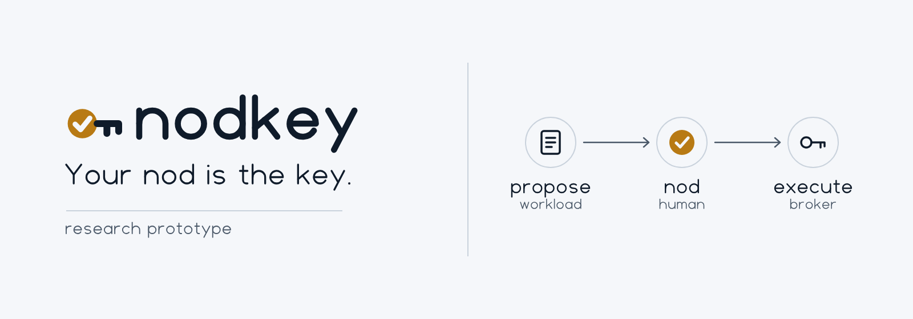
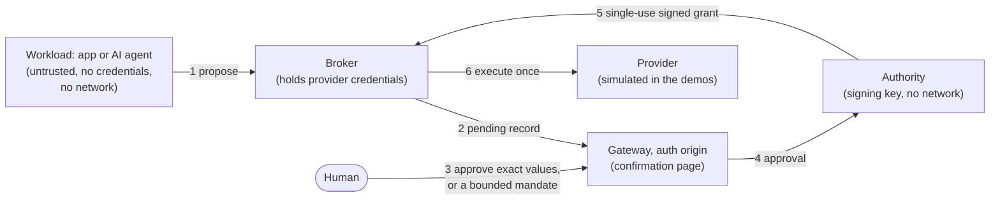

<picture>
  <source media="(prefers-color-scheme: dark)" srcset="assets/readme/hero-dark.png">
  
</picture>

# Nodkey

**Your nod is the key.**

An AI agent or an app proposes consequential actions such as payments, refunds, or messages. An
action executes only after a human approves exactly that action, or when it fits a bounded mandate the
human set earlier. A separate broker holds the provider credentials; the app never does.

[Why](#why) · [Demos](#demos) · [5-minute demo](#5-minute-demo-demo-a) · [Requirements](#requirements) · [Limits](#limits) · [Repository map](#repository-map) · [Security](#security-and-contributing) · [License](#license)

---

> [!WARNING]
> **Research prototype. Not for production.** All security reviews were performed by AI agents; no
> independent human audit has been done. See [LIMITATIONS.md](LIMITATIONS.md).

> **Compromise of computation must not imply compromise of authority.**

Nodkey separates an application's ability to compute from its authority to cause consequential
effects. An AI agent or an app (the *workload*) can only **propose** actions such as a refund or an
outbound message. A separate **broker**, which alone holds the provider credentials, executes an action
only if it carries a single-use grant signed by a separate **authority**, and the authority signs only
what a human approved, exactly as it was shown to them, or what fits a bounded **mandate** that human
delegated earlier.

## Why

Prompt injection or remote code execution in the workload gives an attacker everything the workload can
do. If the workload holds API keys or database credentials, the attacker holds them too. In Nodkey the
workload holds no credential and has no network route to the protected resource, so taking it over yields
proposals, not authority. Nodkey limits the *consequences* of compromise; it does not prevent
compromise or prompt injection ([VISION.md](docs/VISION.md), [THREAT_MODEL.md](docs/THREAT_MODEL.md)).



Simplified. The real flow has more checks, for example a payments adapter that verifies grants again
before contacting the provider. See [ARCHITECTURE.md](docs/ARCHITECTURE.md) and
[effect-protocol-v2](docs/specs/effect-protocol-v2.md).

## Demos

Each demo runs locally in Docker. The apps are **intentionally vulnerable** (a remote-code-execution
endpoint models a compromised workload). They bind to `127.0.0.1` only and must never be exposed to a
network. Results are copied from [STATUS.md](STATUS.md) (last local runs, 2026-10-25 to 2026-10-28).

| Demo | Directory | Shows | Last result |
|---|---|---|---|
| 1. Containment | [`examples/php-ledger`](examples/php-ledger/README.md) | Arbitrary PHP in the app cannot reach the database or its credential; the same attack succeeds against an unprotected baseline | 65 PASS / 2 NOT APPLICABLE / 0 FAIL; baseline: 24 expected FAILs |
| 2. Confirmed transfer | [`examples/confirmed-transfer`](examples/confirmed-transfer/README.md) | A compromised app can propose a transfer but cannot alter, forge, or replay the approved one | 29/29 PASS |
| P. Confirmed refund | [`examples/confirmed-refund`](examples/confirmed-refund/compose.yaml) | Refunds through a simulated payment provider; the app never holds the provider key; no double refund | 92 PASS / 0 FAIL / 17 NOT TESTED |
| A. AI support agent | [`examples/agent-support`](examples/agent-support/README.md) | A prompt-injected agent's tool calls run only when approved or within a mandate | 75 PASS / 0 FAIL / 14 NOT TESTED |

## 5-minute demo (Demo A)

Demo A needs no model, API key, or account: a deterministic stand-in plays a fully prompt-injected agent.

```sh
tests/demoa/run.sh
```

The script builds the images, runs the scenario twice on fresh stacks, prints a results table, and
stops the stack. It exits with status 2 because 14 rows are NOT TESTED. The first run downloads base
images and compiles the Rust components; this build can take longer than five minutes (it has not been
timed). Step-by-step instructions, the
meaning of each result value, cleanup, and troubleshooting are in [QUICKSTART.md](QUICKSTART.md).

## Requirements

- Linux, or a Linux VM such as [Colima](https://github.com/abiosoft/colima) on macOS. The development
  runs used Colima 0.10.3 (Ubuntu 24.04, AppArmor, Docker default seccomp).
- Docker with Compose v2.
- `bash`, `python3`, `openssl` on the host (used by the run scripts).
- Network access for the first image build (base images, Rust crates).
- Rust (1.99 used) only to build and test the crates outside Docker. The demos compile inside Docker.
- `php` on the host only for the Demo 1 containment suite (`tests/containment/run.sh`).

## Limits

Nodkey does not prevent code execution or prompt injection, does not make permitted actions safe,
and does not protect against a compromised host, kernel, container runtime, broker, gateway, or
authority. Confirmed intent (SI-20) is **PARTIALLY MET**: approval is session-based with a test login,
without passkeys. All providers are simulators. Many rows are NOT TESTED. Details:
[LIMITATIONS.md](LIMITATIONS.md).

## Repository map

| Path | Contents |
|---|---|
| [`broker/`](broker/README.md) | Broker (Rust): verifies grants, owns effect state, executes declared operations |
| [`crates/`](crates/) | Authority, gateway, grant verifier, payments adapter, MCP front (Rust) |
| [`tools/`](tools/) | Simulated payment provider (`simpay`), mail sink, deterministic demo agent |
| [`examples/`](examples/) | The four demo stacks |
| [`tests/`](tests/) | Demo runners and harnesses, integration tests, test vectors |
| [`docs/`](docs/README.md) | Vision, invariants, threat model, architecture, specs, ADRs, research, reviews |
| [STATUS.md](STATUS.md) / [ROADMAP.md](ROADMAP.md) | What is verified; what is planned |

## Security and contributing

Report vulnerabilities as described in [SECURITY.md](SECURITY.md). Contributions: see
[CONTRIBUTING.md](CONTRIBUTING.md).

## License

Apache License 2.0. See [LICENSE](LICENSE) and [NOTICE](NOTICE).
