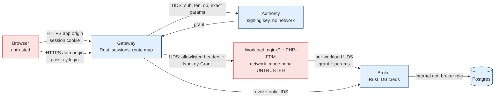

# Architecture

> [!IMPORTANT]
> Status: **DRAFT v0.2** (2026-10-24), revised after the
> [architecture review](reviews/2026-10-24-architecture-review.md). Reflects ADR-0001…0009 (see
> [index](decisions/README.md) for status). Nothing is implemented or tested. The project name is
> **Nodkey** (owner decision, 2026-10-24; replaces the provisional name, OQ-02 resolved).

Nodkey is privilege separation for application effects, in the lineage of OpenSSH privsep, the Chromium
broker, and BeyondProd end-user context tickets ([research 01](research/01-prior-art.md)). The
untrusted workload computes; a broker holds credentials and executes typed operations only when a
grant, policy, and current trusted state all agree.

## 1. Components

| Component | Trust | Role | ADR |
|---|---|---|---|
| **Gateway** (Rust) | TCB | Only public listener. Serves the app origin and the separate auth origin; passkey login; `__Host-` session; parses each request once; route map → one operation with exact-bound params; header/cookie allowlist; response filtering; SW/cache controls | 0001, 0003 |
| **Authority** (Rust) | TCB | Signs grants for the gateway; no network; no workload traffic | 0003, 0004 |
| **Scheduler** (Rust, when background steps exist) | TCB | Issues grants for background transitions derived from broker state | 0009 |
| **Workload**: PHP-FPM (+ optional nginx) + PHP SDK | **Untrusted** | Business logic; receives grant; submits `{grant, params}` | 0001, 0008 |
| **Broker** (Rust) | TCB | Per-workload UDS; strict verification; typed validation; Cedar; locked budgets; consumption; workflow state machine; audit rows | 0002, 0004–0007, 0009 |
| **DB** (Postgres) | Protected | Broker role only | 0001, 0006 |

Outside the TCB: the workload (PHP, extensions, Composer packages, SDK, nginx), browser code,
workflow orchestrators, container logs (never audit evidence), `verify` tooling.

## 2. Diagram

## 3. Request flow: "refund $25 on order 9821"

**T** = trusted fact. **U** = untrusted (a request, never a fact).

1. Earlier: the user logged in with a passkey on `auth.<domain>`; the gateway set
   `__Host-nodkey_session` on the app host via its reserved callback (**T**).
2. Browser → gateway: `POST /orders/9821/refund`, body `{"amount_cents":2500}`, cookie. (**U**)
3. Gateway: session lookup → `sub=u-17`, `ten=acme` (**T**); strict parse of path and JSON body
   (duplicates rejected, size cap); route map → `ledger.refund`, `res={order:9821}`,
   `con={amount_cents: ==2500, currency: ==USD}` — both `exact` (**T**, derived from the user's request).
4. Gateway → authority: the derived scope; authority signs `{iss, aud=broker, wid=shop-php, ten, sub,
   op, opv, res, con, iat, nbf, exp=+30 s, jti}` (**T**).
5. Gateway → workload: allowlisted headers, app-owned cookies only, the same body bytes it parsed,
   and `Nodkey-Grant`. (**U** from here.)
6. Workload → broker: `{grant, params:{order:9821, amount_cents:2500, currency:"USD"}}`. (**U**)
7. Broker: socket → `wid` + `SO_PEERCRED` (**T**); verify grant (ADR-0004); `sub`/`ten` sourced from
   it; params must equal `con`.
8. Broker transaction (ADR-0006): lock budget rows `(acme,u-17,day)`, `(acme,day)` → lock order row
   `WHERE tenant_id='acme' AND id=9821` → check `revoked_before`, pending UNKNOWN → Cedar on facts →
   insert `consumed_grant` → guarded writes (refund, budgets) → audit row → `COMMIT`. A deny after
   verification records `DENIED` for the `jti`.
9. Broker → workload: unsigned outcome + audit row id (evidence only).

A compromised workload cannot change the amount, order, user, tenant, or workload, or reuse the grant.
It can drop or delay the request (≤ 30 s), lie to the user, leak data, or — while the user's tab is
open — make the browser send other real requests (THREAT_MODEL R-3).

## 4. Deployment profile P0

Containers: `gateway`, `authority`, `app` (PHP-FPM; nginx optional as a second untrusted container),
`broker`, `db` (+ `scheduler` when ADR-0009 background steps exist). This supersedes research 03 §8's
four-container minimum.

- Workload: `network_mode: none`, read-only rootfs, `cap_drop: [ALL]`, `no-new-privileges`, default
  seccomp/LSM, private IPC/PID, distinct non-root UID, empty env, pids/memory limits, log driver
  `max-size`/`max-file`. Every writable mount — including the gateway↔app and app-internal FastCGI
  socket volumes — is tmpfs with `noexec,nosuid,nodev` and a size cap. Broker socket mounted read-only.
- Gateway: `edge` network only; no route to `data`.
- Authority: no network; one UDS shared with the gateway only.
- Broker: `data` network; no egress or metadata access.
- DB: internal only, no published ports, `pg_hba` broker-only; storage on a filesystem the workload
  cannot fill.
- `verify` probes per research 03 §7, plus: exec from each writable mount (expect EACCES), file
  persistence across recreate (expect absent), `Service-Worker: script` rejected, gateway-owned
  `Set-Cookie` from the app dropped, non-allowlisted request headers absent at the app.

**P1** = P0 + gVisor for workload containers. WASI is a research track.

## 5. Invariant enforcement map

| SI | Enforced by | Verified by (planned) |
|---|---|---|
| SI-01 | P0 workload config | N-01..08, F-02, C-01..07 |
| SI-02 | Secrets only in TCB containers; gateway allowlist; auth origin | F-01; header-allowlist probes |
| SI-03 | `pg_hba` + role | D-01 |
| SI-04 | No authority conditioned on signatures | Review |
| SI-05 | Keys only in authority/scheduler | F-04; forged-grant vectors |
| SI-06 | Broker verifier; parameter classification; startup check | Vectors 12, 18, 19; unclassified-param startup test |
| SI-07 | No attenuation; params == / ≤ `con` | Vector 19 |
| SI-08 | Strict decoder; Cedar adapter | Vectors 1–17; B-01 |
| SI-09 | Consumption in effect transaction; DENIED recording | Vectors 21–23; **not claimed** across restore/clock rollback until ADR-0006 §8–9 tested |
| SI-10 | Grant-sourced `sub`/`ten`; DB facts | ID-substitution tests |
| SI-11 | Explicit locks, fixed order; guarded writes; locked budget counters | N = 64 cross-resource budget tests |
| SI-12 | Broker-owned workflow state; unsigned outcomes | Outcome-replay tests |
| SI-13 | Config not mounted in workload | F-03, F-04 |
| SI-14 | Deployment-only administration (v0 note) | NOT TESTED |
| SI-15 | Fail-closed handling; UNKNOWN state + precondition | Fault injection |
| SI-16 | Operation registry | B-01; review |
| SI-17 | Docs process; `verify` result classes | Doc review |
| SI-18 | Gateway: auth origin, cookie flags, SW block, Set-Cookie filter | Gateway probes above |
| SI-19 | Operation authority classes; startup check; single-tenant rule | Grantless-op tests |

## 6. Adoption modes

**Legacy Containment** (no SDK, no route map): network/OS isolation and evidence; credential removal
for allowlisted egress needs an egress proxy not in v0. No per-user or per-effect authorization. An app
that keeps its own DB credential, **or its own login form**, is not contained for those channels. Under
strict P0 an unmodified app that needs its own DB does not run; Legacy Containment needs its own,
not-yet-written profile.

**Native Effect Authorization** (gateway login, route map, typed operations, SDK): the flow in §3.
Limits: THREAT_MODEL R-2..R-7, especially in-page abuse while a user is active, bounded by budgets.
Migration from Legacy is route by route; login moves to the auth origin first.

**Comparison baseline:** for internal-DB-only effects, P0 isolation + PostgREST RPC-only + RLS with a
gateway-signed JWT provides essentially the same guarantees with less new code (ADR-0002, AR-14).
Nodkey's distinct value is the gateway binding, external-effect handling, and multi-workload identity;
OQ-01 remains open until that baseline is tested.
