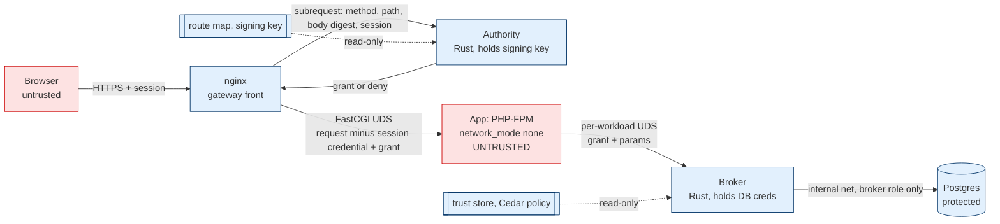

# Architecture

> [!IMPORTANT]
> Status: **DRAFT v0.1** (2026-10-24). Reflects ADR-0001…0008, all *Proposed*. Nothing is
> implemented or tested. "Proof-Bound Execution" (PBE) is a **provisional internal name**; renaming
> is an owner decision (see [research 05 §3](research/05-governance-licensing-naming.md) and OQ-02).

PBE is privilege separation for application effects, in the lineage of OpenSSH privsep, the
Chromium broker, and BeyondProd end-user context tickets ([research 01](research/01-prior-art.md)).
The untrusted workload computes; a separate broker holds credentials and executes typed operations
only when a gateway-issued grant, broker policy, and current trusted state all agree.

## 1. Components

| Component | Trust | Role | ADR |
|---|---|---|---|
| **nginx** (gateway front) | Trusted config, untrusted traffic | TLS/HTTP ingress; FastCGI to the app over UDS; calls the authority per request; never holds signing keys | 0001, 0003 |
| **Authority** (Rust) | Trusted (TCB) | Verifies the user session; removes the session credential; maps the request through the route map to an operation scope; signs a single-use grant | 0003, 0004 |
| **App workload** (PHP-FPM + PHP SDK) | **Untrusted** | Business logic; receives the grant; computes concrete parameters; submits `{grant, params}` to the broker | 0001, 0008 |
| **Broker** (Rust) | Trusted (TCB) | Per-workload UDS listener; strict grant verification; typed parameter validation; Cedar; in-transaction state checks, consumption, and effect; workflow state machine; receipts | 0002, 0004–0007 |
| **Protected DB** (Postgres) | Trusted resource | Accepts only the broker role; holds orders, ledger, consumption, workflow, audit tables | 0001, 0006 |
| **Key / policy / route-map files** | Trusted config | Read by authority or broker only; changed only by the operator | 0001, 0005 |

Outside the TCB: the app and everything it loads (PHP runtime, extensions, Composer packages, the
PHP SDK), the browser, any workflow orchestrator, log viewers, and `verify` tooling (which reports
but enforces nothing).

## 2. Diagram

## 3. Request flow: "refund $25 on order 9821"

**T** = trusted fact. **U** = untrusted (a request, never a fact).

1. Browser → nginx: `POST /orders/9821/refund`, body `{"amount_cents":2500}`, session cookie. (**U**)
2. nginx → authority: method, raw path, body digest, session credential. (**U** inputs to a **T** component)
3. Authority:
   - verifies the session in its session store → `sub=u-17`, `ten=acme` (**T**);
   - parses the path once, strictly, and looks it up in the route map → op `ledger.refund`,
     resource `{order: 9821}` (**T**, derived from the user's own request);
   - sets the constraint ceiling: `amount_cents_max` = route-declared rule (see ADR-0003 objection:
     here the body supplies the amount, so the ceiling should equal 2500), `currency=USD` (**T**);
   - signs a grant: `iss, aud=broker, wid=shop-php, ten=acme, sub=u-17, op, opv, res, con, rqh,
     nbf/exp (≤ 300 s), jti, epo` (**T**).
4. nginx → app over FastCGI: request with the session credential removed, plus the grant. (**U**
   from here on: the app may alter, drop, or misuse anything.)
5. App → broker over `/run/pbe/broker.sock`: `{grant, params: {order: 9821, amount_cents: 2500}}`.
   Any extra fields such as `owner_id` or `tenant` are rejected by the typed schema. (**U**)
6. Broker, identity: socket the request arrived on → `wid=shop-php`; `SO_PEERCRED` UID = 10001 (**T**).
7. Broker, grant: strict COSE_Sign1 verification against the trust store (ADR-0004); `aud`, `wid`,
   time, epoch, and `op` checked against **T** values; `params` checked against `res` and `con`.
8. Broker, transaction (ADR-0006): `BEGIN` → `INSERT consumed_grant(iss, jti, …)` → `SELECT … FROM
   orders WHERE tenant_id='acme' AND id=9821 FOR UPDATE` (**T**) → load budgets and roles (**T**) →
   Cedar (ADR-0005) on facts only → guarded `UPDATE … WHERE refunded_cents + 2500 <= total_cents`
   (rows = 1) → ledger rows → audit row → `COMMIT`. Any error ⇒ rollback ⇒ Deny.
9. Broker → app: result and a receipt (evidence only, SI-12). (**U** once it reaches the app.)

A compromised app at step 5 cannot change the order, operation, user, tenant, or workload, cannot
exceed the ceiling, and cannot reuse the grant. It **can** choose any amount up to the ceiling,
withhold the request, lie to the user, or drive the browser to send other real requests
(THREAT_MODEL R-2, R-3).

## 4. Deployment profile P0

Defined in [research 03 §6](research/03-runtime-isolation.md#6-deployment-profile-p0-poc); summary:

- `app`: `network_mode: none`, `read_only: true`, `cap_drop: [ALL]`, `no-new-privileges`, default
  seccomp and LSM (never `unconfined`), private IPC/PID, non-root distinct UID, empty environment,
  `noexec` tmpfs. Only two channels: the FastCGI UDS volume shared with nginx and its own broker
  socket volume, mounted **read-only**.
- `nginx`: edge network only; `fastcgi_ignore_headers X-Accel-Redirect`; no `proxy_pass` to
  anything but the authority.
- `authority`: reachable only from nginx; holds the signing key and route map. *(Addition to the
  03 sketch, which has no authority container; see ADR-0001 objection.)*
- `broker`: on the internal `data` network and its per-workload socket volumes; holds the DB secret;
  no internet egress, no metadata access.
- `db`: internal network only, no published ports, `pg_hba` admits only `pbe_broker` with SCRAM.
- Every element maps to a `verify` probe (03 §7); result classes PASS / FAIL / NOT TESTED /
  NOT APPLICABLE / INCONCLUSIVE.

**P1** = P0 + `runtime: runsc` (gVisor) for `app`, optionally Landlock applied by a launcher and
rootless runtime. Reduces host-kernel exposure (R-1); does not change reachability rules.
WASI (architecture B) is a research track, not a PoC dependency.

## 5. Invariant enforcement map

| SI | Enforced by | Verified by (planned) |
|---|---|---|
| SI-01 No direct reach | P0 container config (`network_mode: none`, mount allowlist) | Probes N-01..08, F-02, C-01..07 |
| SI-02 No credential custody | Secrets mounted only in broker/db/authority; authority strips session credential | F-01 canary search; gateway strip test |
| SI-03 No alternate path | Postgres `pg_hba` + role auth; no other principal on `data` | D-01 |
| SI-04 Signed ≠ trusted | No component conditions authority on artifact signatures | Design review |
| SI-05 No self-minting | Signing key only in authority container; broker holds public keys only | F-04; forged-grant vectors |
| SI-06 Full binding | Broker grant verifier vs transport `wid`, trusted `aud`, clock; params vs `res`/`con` | 02 §8 vectors 12, 18 |
| SI-07 No broadening | No attenuation or combination in v1; params ⊆ constraints | Vector 19; property tests |
| SI-08 Default deny | Strict decoder (ADR-0004); Cedar adapter (ADR-0005); unknown op ⇒ deny | Vectors 1–17; B-01 |
| SI-09 At-most-once | `consumed_grant` insert in the effect's transaction (ADR-0006) | Vectors 21–23 |
| SI-10 Trusted facts only | Broker fact layer; subject/tenant from grant, ownership/state from DB; app claims rejected | ID-substitution property tests |
| SI-11 Current state | `SELECT … FOR UPDATE` / serializable + guarded writes | Concurrency tests |
| SI-12 Receipts ≠ authority | Broker-owned workflow state machine (ADR-0007) | Receipt-replay tests |
| SI-13 Policy out of reach | Config not mounted into app; read-only rootfs | F-03, F-04 |
| SI-14 Independent admin | **Partial:** operator host access only; no admin API in v0 | NOT TESTED (THREAT_MODEL R-9) |
| SI-15 Fail closed | Broker error handling; RESERVED→…→UNKNOWN state machine | Fault injection (store down, Cedar error) |
| SI-16 Bounded interface | Broker operation registry with typed schemas (ADR-0002) | B-01; interface review |
| SI-17 Claims tested | Documentation process; `verify` result classes | Doc review |

## 6. Adoption modes

**Legacy Containment** (no SDK, no route map). Offers network and OS isolation, credential removal
for allowlisted HTTP egress (via an egress proxy that is **not** part of v0), and evidence of
outbound calls. Honest limits: no per-user or per-effect authorization; a compromised app retains
every authority its remaining channels give it; if the app keeps a direct DB credential, DB access
is **not contained at all**. Under strict P0 the app has no DB route, so an unmodified app that
needs its database does not run: Legacy Containment needs its own profile, not yet written.
Claim: reduces blast radius from "everything reachable plus every secret" to "what the app's
existing channels allow" ([research 04 §6](research/04-authorization-policy.md)).

**Native Effect Authorization** (SDK + route map + typed operations). Provides the flow in §3:
grant-bound, policy-checked, state-checked, at-most-once effects. Limits: residuals R-2..R-7 in the
threat model, in particular that a compromised app can use in-flight grants within their ceiling and
can drive logged-in browsers to send real requests. Budgets and (future) gateway-origin approval are
the bound on those. Migration from Legacy is route by route.
