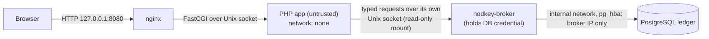

# php-ledger — containment demo (Demo 1)

> [!CAUTION]
> **Intentionally vulnerable.** This application contains a remote-code-execution endpoint
> (`POST /debug/eval`) so that "an attacker is running arbitrary PHP inside the app" can be
> demonstrated and tested. It binds to `127.0.0.1` only. Never expose it to a network.

## What it demonstrates

An attacker who can run arbitrary code inside the PHP application **cannot** reach the ledger
database, find its credential, or change balances except through the broker's declared
operations — under Deployment Profile P0. The same attack **succeeds** against a conventional
deployment of the same app, which is included as a positive control.

| Profile | File | App network | App holds DB credential | Expected attack outcome |
|---|---|---|---|---|
| `baseline` | `compose.baseline.yaml` | on the DB network | yes (env vars) | succeeds |
| `protected` (P0) | `compose.protected.yaml` | none (loopback only) | no | fails |



## Run it

Requires Docker with Compose v2 on Linux (on macOS, a Linux VM such as Colima).

```sh
tests/containment/run.sh both        # baseline (positive control), then protected
```

Results are printed as a table and written to `var/containment/results-<profile>.json`
(Git-ignored). The script exits 0 only if every protected-profile result is `PASS` or
`NOT APPLICABLE`.

To explore manually:

```sh
tests/containment/run.sh protected   # or start it yourself:
docker compose -f examples/php-ledger/compose.protected.yaml up -d --build --wait
open http://127.0.0.1:8080/
curl -s -X POST --data-binary 'var_dump(@fsockopen("db", 5432));' http://127.0.0.1:8080/debug/eval
docker compose -f examples/php-ledger/compose.protected.yaml down -v
```

## Known limitations of this demo

These are real gaps, recorded in
[`docs/reviews/2026-10-25-demo1-code-review.md`](../../docs/reviews/2026-10-25-demo1-code-review.md):

- **No business-level authorization yet.** The broker enforces the operation type and a per-call
  amount limit only. A compromised app can still move money between any accounts, up to that
  limit per call, as often as it likes (D1-06). Per-user grants (Phase 3) and budgets (Phase 4)
  address this; until then, Demo 1 shows **containment of credentials and reach**, not
  containment of permitted operations.
- **Container logs are not an audit trail.** The app can flood broker requests and rotate the
  broker's log away (D1-04). Committed transfers are recorded in the database; denied attempts
  are not yet durably recorded.
- **One database connection, no per-workload fairness** (D1-07). A busy or hostile workload can
  slow every other workload.
- **Local VM only.** Verified on Colima (Ubuntu 24.04, kernel 6.8) with Docker's default seccomp
  and AppArmor profiles. Not tested: production hosts, rootless Docker, gVisor, cloud metadata
  services.
- **Kernel exploits are out of scope.** A container escape defeats P0; profile P1 (gVisor) is
  planned for that threat.
